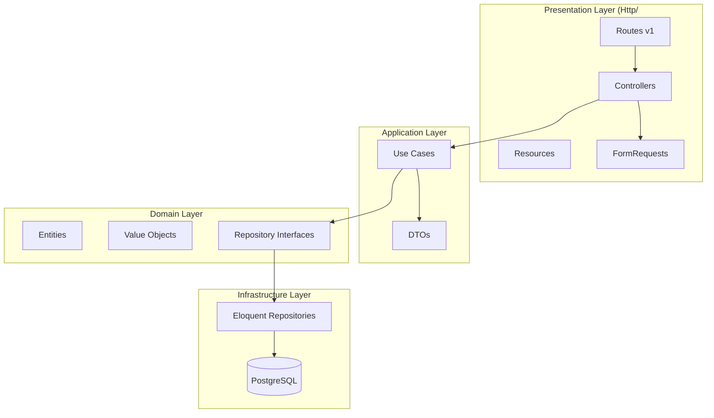

# Architecture

## Overview

Laravel DDD is a modular monolith API built with Laravel 12 and PHP 8.5, applying Domain-Driven Design (DDD) patterns where domain complexity justifies them.

## Layered Architecture

The codebase follows four layers:

```
src/be/app/
├── Domain/              # Enterprise business logic (entities, VOs, repository interfaces)
├── Application/         # Use cases + DTOs (orchestrates domain)
├── Infrastructure/      # External concerns (Eloquent repositories)
└── Http/                # Presentation layer (controllers, resources, requests)
```

### Domain Layer

Contains the core business model. Entities extend Eloquent Model but encapsulate domain behavior. Value Objects are immutable and self-validating. Repository interfaces define contracts without infrastructure knowledge.

**Bounded contexts:**
- `Cars` — vehicle inventory (brand, model, year, price, status)
- `Users` — user accounts (email, role)
- `Orders` — customer orders (user, total, status, lifecycle)
- `Products` — product catalog (name, SKU, price, stock)
- `AuditLog` — immutable change trail (actor, action, subject, changes)
- `Invoices` — billing documents (order, amount, status, due date)
- `Payments` — payment transactions (order, amount, method, status)
- `Notifications` — outbound messages (recipient, channel, content, status)

### Application Layer

Use cases orchestrate domain objects. DTOs transfer data between presentation and application. No infrastructure or HTTP concerns here.

### Infrastructure Layer

Eloquent implementations of repository interfaces. Swappable per boundary (e.g., replace Eloquent with Doctrine or an external API).

### Presentation Layer

REST API v1 controllers, API Resources, FormRequests, and routes.

## Design Principles Applied

| Principle | Where Applied | Why |
|-----------|--------------|-----|
| DDD (bounded context, aggregate, VO) | Cars, Users, Orders, Products, AuditLog, Invoices, Payments, Notifications | Real domain complexity and invariants |
| SOLID | Repository interfaces, Use Cases | Classes have single reason to change; concrete coupling blocked by interfaces |
| Clean/Hexagonal | Repository pattern | External systems (DB) can be swapped — `MODE=standalone` stub adapters possible |
| DRY | Shared Pagination criteria, Base UseCase patterns | Same logic repeated across domains |
| EDA | Domain events in Orders/Payments/Notifications | Real async reactions between modules |
| KISS / YAGNI | Always | No speculative layers; CRUD-style code stays simple |

## Where Principles Are Not Applied

| Principle | Reason |
|-----------|--------|
| Full Event Sourcing | No requirement for full event replay; snapshots suffice |
| CQRS | Read and write models are identical for current scope |
| Microservices | Single deployable monolith; no team boundaries |

## ADRs

Architecture Decision Records live in `docs/adr/`.

## Diagram


